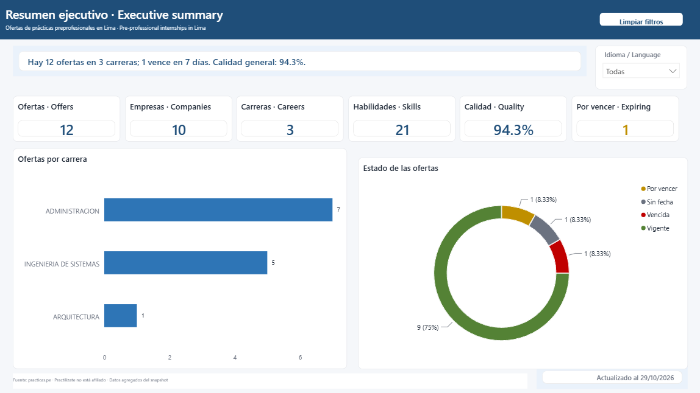
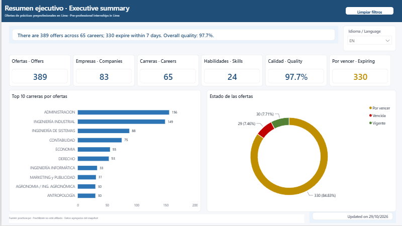
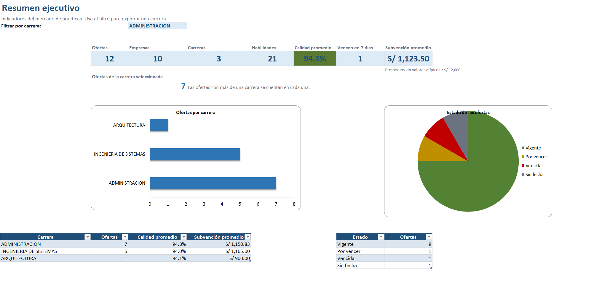
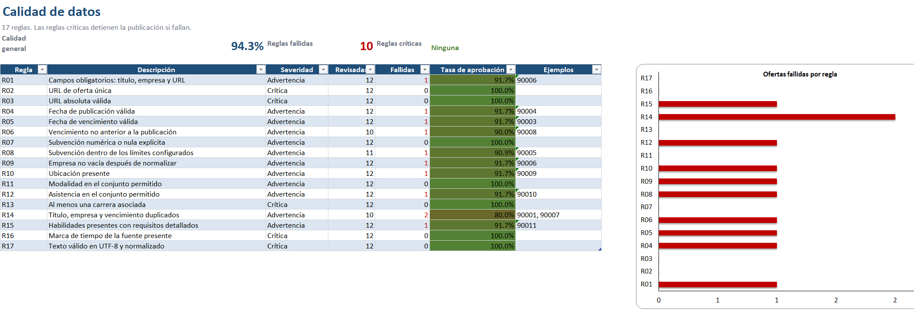

# Practilizate

**Observatorio de prácticas preprofesionales del Perú.**

Practilizate turns public internship listings into a reproducible data product: a validated PostgreSQL star schema, a Power BI dashboard, an Excel workbook, and a data quality report.

> **Status:** v0.1.2 with a live snapshot (`live-20261029`). The PostgreSQL star schema, Excel workbook, bilingual Power BI report, and E2E artifacts are in the repository.
> **Español:** [README.es.md](README.es.md)

## Why Practilizate

Students apply to internships without comparable data about salaries, companies, required skills, or deadlines. Career centers also lack a current, structured view of the market.

Practilizate answers:

- Which skills are most requested by career and district?
- Which companies publish the most internship offers?
- What salary ranges appear by role and career?
- Which offers are about to expire?
- How complete and reliable is the published data?

The initial 73-offer analysis was limited to Systems Engineering in Lima. The product is designed for **all careers**.

## What it includes

- Multi-career ingestion from practicas.pe.
- Normalization of company, location, salary, dates, careers, and skills.
- Data quality rules with a visible report.
- PostgreSQL star schema with career and skill bridges.
- Power BI report with Spanish/English toggle.
- Excel workbook in Spanish.
- Repeatable E2E test and artifact manifest.
- Bilingual documentation.

## Architecture

```text
practicas.pe
    |
    v
[ingest] cache + rate limit
    |
    v
[normalize] canonical offers
    |
    v
[quality] rules + report
    |
    v
[load] PostgreSQL star schema
    |
    +--> [export] dashboard_dataset.csv
    +--> [export] practilizate.xlsx
    +--> [powerbi] practilizate.pbip
```

## Demo









- Dashboard (Spanish): `docs/assets/dashboard-es.png`
- Dashboard (English): `docs/assets/dashboard-en.png`
- Excel summary: `docs/assets/excel-summary.png`
- Data quality report: `docs/assets/quality-report.png`
- Power BI guide: [powerbi/README.md](powerbi/README.md)

## Data source and attribution

Data comes from public listings on [practicas.pe](https://www.practicas.pe/).

- Practilizate is **not affiliated** with practicas.pe.
- The project uses public data for educational and research purposes.
- Only aggregated data is published. Raw scraped HTML and personal data are not included.
- The live CSV and Excel workbook stay outside Git (`data/processed/`); the
  public screenshots show aggregate counts only.
- The collector respects `robots.txt`, rate limits, and caching.
- See [DATA_SOURCES.md](DATA_SOURCES.md) and [NOTICE.md](NOTICE.md).

## Quickstart

```powershell
git clone <repository-url>
cd practilizate
python -m venv .venv
.venv\Scripts\Activate.ps1
pip install -e ".[dev]"
docker compose up -d db
Copy-Item .env.example .env
python -m practilizate run --source fixtures --as-of 2026-10-29
pytest tests/e2e
```

The default `fixtures` mode is deterministic and does not call the live site.
For the live snapshot:

```powershell
python -m practilizate run --source live --as-of 2026-10-29
```

Docker Compose maps PostgreSQL to host port **5433**; `.env.example` already
uses that port. Live ingestion uses a cache, a configurable rate limit, and
the public site's career filter (65 careers at the snapshot date).

## How to use Practilizate

**1. Review the result without installing anything**

Open the GitHub release, the screenshots, and `powerbi/practilizate.pbip` in
Power BI Desktop. The PBIP includes the report definition; save it as `.pbix`
if you need a single portable file.

**2. Run the pipeline locally**

Follow the Quickstart above. The `fixtures` mode is deterministic and is the
best way to verify the installation. Use `--source live` for real listings.

**3. Use the deliverables**

- `data/processed/practilizate.xlsx` — Spanish workbook for students and career centers.
- `data/processed/dashboard_dataset.csv` — Power BI/analyst snapshot.
- `powerbi/practilizate.pbip` — bilingual report source.
- PostgreSQL `v_dashboard_ofertas` — optional live-analysis view.

**4. Share it online**

The current product is a local CLI + Power BI Desktop + Excel workflow, not a
hosted web application. To share a dashboard with other people, publish the
PBIP to a Power BI workspace (requires a Power BI account/license) or host a
web application on top of the CSV/PostgreSQL data. The public repository
publishes aggregated screenshots and evidence; the live CSV/Excel stay local.

**5. Automate a refresh**

Schedule `python -m practilizate run --source live --as-of <date>` with Task
Scheduler or cron. The collector caches responses and respects the configured
rate limit. The E2E suite uses fixtures and never calls the public site.

## Power BI

Open `powerbi/practilizate.pbip` in Power BI Desktop and save it as `.pbix` if needed.

- v0.1 uses `data/processed/dashboard_dataset.csv` plus the support CSVs for portability.
- The model reads the snapshot through the `DataFolder` parameter; update it if the repository moves.
- The six pages cover executive summary, skills, companies and compensation, deadlines, quality, and a bilingual help page.
- The report includes an ES/EN toggle (`Idioma` table and DAX `SWITCH` measures), alt text, accessible colors, a source footer, and a `Limpiar filtros` button.
- PostgreSQL is documented as an optional live source in [powerbi/README.md](powerbi/README.md).

## Excel

The workbook is generated at `data/processed/practilizate.xlsx` and includes:

- `Portada`
- `Datos`
- `Resumen`
- `Habilidades`
- `Empresas`
- `Calidad`
- `Diccionario`

## Testing

- E2E only. No unit tests.
- The E2E suite runs the full pipeline against a disposable PostgreSQL database.
- It uses a medium-to-hard **synthetic fixture set**: multi-career offers, duplicates, missing salary, invalid dates, outliers, and missing fields.
- The live snapshot is validated separately and is not fetched by CI.
- Each E2E run writes a repeatable synthetic artifact to `artifacts/e2e/`:

```text
artifacts/e2e/
├─ run_manifest.json
├─ quality_report.json
├─ normalized_offers.json
├─ database_load.json
├─ export_report.json
├─ practilizate.xlsx
├─ dashboard_dataset.csv
├─ offer_careers.csv
├─ offer_skills.csv
├─ quality_rules.csv
├─ run_metadata.csv
├─ dim_idioma.csv
├─ dim_estado.csv
└─ checksums.sha256
```

`artifacts/e2e/` is generated and gitignored; CI uploads it as an artifact and
the release attaches it.

## Results

> Live snapshot `live-20261029` (`--source live --as-of 2026-10-29`), fetched
> from the public site with a 1 s rate limit. Counts are point-in-time.

| Metric | Value |
|---|---|
| Offers processed | 389 |
| Companies | 83 |
| Careers | 65 |
| Skills | 24 |
| Quality score | 97.7% |
| Offers expiring within 7 days | 330 |
| Pipeline runtime | 530.6 s (~8.8 min, PostgreSQL included) |

The quality report flags 3 warning rules and no critical rule: R06 (1 offer with
a deadline before publication), R14 (38 duplicate title + company + deadline
groups), and R15 (113 offers with detailed requirements but no lexicon skill).
Salary is published for 156 of 389 offers; averages exclude missing values and
outliers above S/ 12,000. See [docs/fixtures.md](docs/fixtures.md) for the
synthetic E2E contract and [docs/data-dictionary.md](docs/data-dictionary.md)
for field definitions.

## Nielsen heuristics

The product follows the 10 usability heuristics in [docs/heuristics.md](docs/heuristics.md). Review evidence is complete in [docs/heuristics-review.md](docs/heuristics-review.md), using the screenshots above, the Excel workbook, the quality report, and the E2E manifest.

## Data dictionary

Field definitions for the star schema, CSV snapshot, quality report, and manifest are in [docs/data-dictionary.md](docs/data-dictionary.md).

## Project structure

```text
practilizate/
├─ AGENTS.md
├─ SPECS.md
├─ ROADMAP.md
├─ README.md
├─ README.es.md
├─ CODESTYLE.md
├─ DATA_SOURCES.md
├─ NOTICE.md
├─ LICENSE
├─ docs/
├─ src/practilizate/
├─ sql/
├─ tests/e2e/
├─ data/fixtures/
├─ data/processed/
├─ artifacts/e2e/
├─ powerbi/
├─ scripts/
├─ docker-compose.yml
├─ pyproject.toml
├─ .env.example
└─ .github/workflows/ci.yml
```

## Limitations

- v0.1 covers Lima and pre-professional internships.
- Public listings may omit salary, deadlines, or detailed requirements. In the
  live snapshot, 233 of 389 offers do not publish a salary.
- The skill lexicon covers 24 canonical skills; 113 live offers have detailed
  requirements but no lexicon match. Expanding the lexicon is a v0.2 task.
- The live snapshot is point-in-time; 330 offers expire within 7 days of the
  cutoff because many deadlines cluster around the same dates.
- R14 flags 38 duplicate title + company + deadline groups; they remain visible
  for audit instead of being silently removed.
- The site structure can change; fixtures protect the test suite.
- The project is an observatory, not an application tracker.
- Data quality is reported, not hidden.

## License

Code: MIT. See [LICENSE](LICENSE).

Data and derived datasets are not covered by the MIT license. See [DATA_SOURCES.md](DATA_SOURCES.md).
